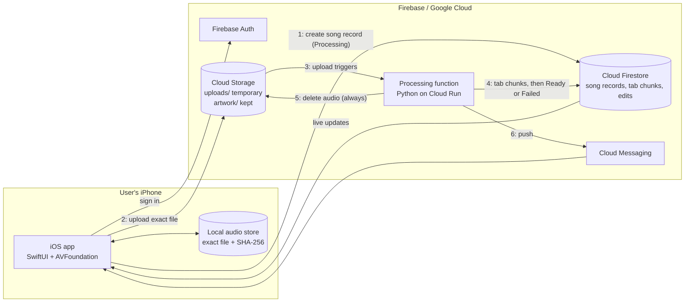

# Amphion architecture

This file is the technical context every Issue relies on. It covers how Amphion is built: the parts, how data moves between
them, which calls are allowed, and the rules an agent must not break. It describes the target system from
[SDD v0.3](docs/SDD.pdf) Section 5. Most of that system is not built yet; the [roadmap](ROADMAP.md) says which phase builds
each part. Product rules (scope, privacy, accounts, wording) are in [POLICY.md](POLICY.md).

The SDD is the authority. This file points to it by ID (US, RC, DD, RISK, OQ) and does not restate it. If this file, an Issue
and the SDD disagree, stop and ask in an Issue comment. Do not pick one yourself.

## System at a glance

Amphion has three parts (SDD 5.1, Figure 1): a native iOS app, Firebase, and a Python processing function on Google Cloud.
The processing function is the only part that touches audio content in the cloud, and it deletes that audio when it ends.

## Components

| Component | Technology | Repo folder | Responsible for | SDD |
| --- | --- | --- | --- | --- |
| iOS app | Swift, SwiftUI, AVFoundation; iPhone, iOS 17+ | `ios/` (P0-02) | All screens, recording and import, the local audio store, playback and the song-time clock, drawing the tab, edits | DD-04, RC-14 |
| Firebase Auth | Apple, Google, email and password providers | Firebase console (P0-03) | Who the user is, on every request | RC-01, DD-10 |
| Cloud Firestore | Firestore with per-user security rules | `firebase/` (rules, schema) | Song records, status, tab data in bar-range chunks, chord names, song details, edits, folders | RC-02, RC-20 |
| Cloud Storage | Cloud Storage for Firebase | `firebase/` (rules) | Uploaded audio until its job ends; song artwork, kept | RC-03, DD-13 |
| Processing function | Python on Cloud Run functions: Demucs, Basic Pitch, the tab-assignment module, madmom, librosa | `pipeline/` | Separating guitar and bass, finding notes, choosing string and fret, beats, chords, key, tempo, tuning; writing results; deleting the audio | DD-02, DD-03, DD-15, DD-16 |
| Cloud Messaging | Firebase Cloud Messaging through APNs | Firebase console; sent from `pipeline/` | "Your song is ready" and failure notifications | US-06 |
| Benchmark | Python, mir_eval | `benchmark/` | The 10-song reference set and accuracy scoring. Runs offline and is never deployed. | RC-10, RISK-01 |
| React demo | React, Vite, Tailwind | repo root today, `demo/` after P0-01 | A click-through design reference for every screen. It is never shipped and never ported line for line. | SDD 6.3 |

## Data flow

Submitting a song (US-04 to US-06, DD-05):

1. The app copies the recording or imported file into its local audio store unchanged. It records the duration and a SHA-256
   fingerprint (RC-19).
2. The app creates `users/{uid}/songs/{songId}` with status Processing, then uploads the same file, unchanged, to
   `uploads/{uid}/{songId}`.
3. The upload triggers the processing function. The function checks that the song record exists, belongs to that `uid` and is
   Processing. It checks file type and length again (RC-07).
4. The function analyzes the audio. It writes every tab chunk first and sets the song to Ready, with key, tempo and tuning, last.
   Any error or timeout sets Failed instead (RC-09).
5. The function deletes the uploaded audio on every path: success, failure, rejection and timeout (RC-03).
6. The function sends a push notification. The Library already shows the new status, because the app listens to Firestore.

Retry after Failed uploads the phone's copy again, because the cloud copy is already gone (P4-04).

Practicing a song (US-07 to US-14) needs nothing from the cloud beyond the saved results. The app plays its local file and
draws the tab from the stored data (RC-18, RC-19). If the local file is missing or its fingerprint does not match, the
Song screen shows the tab without synced playback (OQ-03).

## Allowed calls

| From | To | Allowed |
| --- | --- | --- |
| iOS app | Firebase Auth | Yes |
| iOS app | Firestore | Only the signed-in user's own documents. It may create a song record as Processing and write edits, folders, titles, artists and the display name. It never writes tab results and never sets Ready. |
| iOS app | Storage | Upload its own audio to `uploads/{uid}/…` and its own artwork to `artwork/{uid}/…` |
| iOS app | Processing function | **Never.** No HTTP call, callable function or queue (DD-05) |
| iOS app | Any other online service | No. That includes song recognition (DD-12) and streaming services (SDD 2.3). |
| Processing function | Storage | Read and delete the upload that triggered it. Never write separated parts or any other audio. |
| Processing function | Firestore | Write tab chunks, song details and status for the song it is processing |
| Processing function | Cloud Messaging | Send that song's owner a notification |
| Anyone | Another user's data | Never (RC-02). Rules deny by default (P0-04). |

## Data layout

These paths are planned. P2-04 settles them, and after P4-03 `firebase/SCHEMA.md` is the authority for the stored format.

| Where | Path | Kept | Holds |
| --- | --- | --- | --- |
| Firestore | `users/{uid}` | Until account deletion | Display name, settings |
| Firestore | `users/{uid}/songs/{songId}` | Until the song is deleted | Title, artist, folder (one per song, DD-11), duration, fingerprint, created date, status, key, tempo, tuning, schema version |
| Firestore | `…/songs/{songId}/tabs/{instrument}_{chunk}` | With its song | RC-20 notes, beats and downbeats, chord segments, for one bar range (each chunk under 500 KB) |
| Firestore | user's folders | Until deleted | Folder names; deleting a folder moves its songs to All Songs (US-16) |
| Storage | `uploads/{uid}/{songId}` | Only while its job runs | The uploaded audio |
| Storage | `artwork/{uid}/…` | Until the song or account is deleted | Square artwork, at most 1024 × 1024 and 1 MB (RC-17) |
| iPhone | Local audio store | Until the song is deleted on that phone | The exact submitted file, its duration and its fingerprint |

All times are **song time**: seconds from the start of the song's audio file (RC-18).

## Rules agents must keep

Each rule is here because breaking it would quietly break the product. Every Issue that touches the area must keep it.

### A1. One clock

Synced UI reads song time from the audio player and nowhere else (RC-18, DD-14).

- On iOS, `PlaybackEngine` (P5-04) gives the current song time from the player's own render time. The playhead, the highlight
  and auto-scroll read it once per screen refresh (`CADisplayLink` or `TimelineView`).
- Never add a `Timer`, a counter, `asyncAfter`, or any value that moves song time forward on its own.
- Speed changes and loops change only how fast song time moves. The stored tab never changes for them.
- Bluetooth output delay is corrected inside the clock (#31), not in the views.
- The React demo keeps the same rule: `PlaybackClock` in `src/playback/clock.ts` (under `demo/` after P0-01), read in one animation-frame loop.
- This rule traces from US-12 to Issue #29 and its sub-issues P5-04 and P5-05.

### A2. Upload-triggered pipeline

The app starts processing only by uploading to Storage, and it learns the result only from Firestore (DD-05). See Allowed
calls.

### A3. Audio is temporary in the cloud

Uploaded audio is deleted in a `finally` block on every path. Separated guitar and bass parts live only inside the running job,
in memory or its temporary disk, and are never stored. The cloud keeps only results and artwork (RC-03, DD-16). Logs and
error reports never include audio data (raw bytes, samples or separated parts). Log song IDs, durations and errors instead.

### A4. Same audio for analysis and playback

The app uploads exactly the file it keeps, with no trimming or re-encoding. It checks the fingerprint before synced playback
(RC-19).

### A5. Never a partial tab

Ready is set only after every chunk is written, and only by the processing function. The app shows Processing or Failed
until then (RC-09, RC-20).

### A6. Every request is checked

Security rules start from deny-all and allow only the owner. The processing function checks ownership itself instead of
trusting the upload path (RC-01, RC-02).

### A7. No secrets

No API keys, service-account keys or tokens go in the app or in git (RC-06). `GoogleService-Info.plist` stays out of git. It is
treated as public client config protected by security rules, until Elijah decides OD-03. The processing function uses its
service account, never a key file.

### A8. Schema changes need approval

The RC-20 data format is fixed in P1-04 and made formal in P4-03. Changing it needs a schema version bump and Elijah's
approval in the Issue first.

### A9. Accuracy bars are fixed

Any change to the pipeline reruns the benchmark (RC-10) and reports the scores in the PR. Never lower the RISK-01 bars or
switch to the chord-chart fallback without the G1 decision record (`docs/decisions/G1-accuracy.md`).

### A10. Stay on the chosen stack

The technology list is SDD 5.1. Adding a cloud service or SDK, or replacing a pipeline library (RISK-04), is a design change:
ask in the Issue first. No analysis runs on the phone (DD-03).

## Repository layout

| Folder | Holds | From |
| --- | --- | --- |
| `docs/` | The SDD (`SDD.pdf`, plus the text copy `SDD.txt`), task briefs, decision records (`docs/decisions/`), the backlog spec and design screenshots | Today |
| `src/`, `index.html`, `package.json` | The React demo | Today; moves to `demo/` in P0-01 (OD-02) |
| `ios/` | The Xcode project: `App/`, `Features/` (one folder per screen), `Services/`, `Models/`, `DesignSystem/` | P0-01, P0-02 |
| `pipeline/` | The processing function and the analysis code | P0-01, P1 |
| `firebase/` | `firebase.json`, security rules, rules tests, `SCHEMA.md` | P0-01, P0-04 |
| `benchmark/` | Reference tabs (never the audio, OD-04), scoring harness, reports | P0-01, P1-02 |

## Cloud project

Not set up yet. P0-03 (a human task) records here the Firebase project ID, the region and AiDev's IAM role, which is never
Owner or Editor.

## Development environments

The Lab 2 AiDev account works on the React demo. iOS work needs Xcode, which runs only on macOS. P0-06 adds a Standard
(non-admin) AiDev user on the MacBook (OD-01) and writes its setup steps here.
