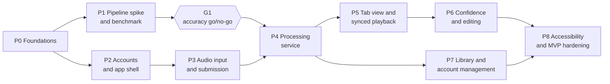

# Amphion roadmap

This file sets the order in which Amphion is built: nine phases, P0 to P8, with one go/no-go gate, G1. It does not track
tasks or status. **The [Amphion GitHub Project](https://github.com/users/etabor3096/projects/1) and its Issues are the
source of truth for what to do next and how far along each item is.** If this file and the Project disagree about a task,
the Project wins. Behavior comes from [SDD v0.3](docs/SDD.pdf). Technical and product rules are in
[ARCHITECTURE.md](ARCHITECTURE.md) and [POLICY.md](POLICY.md).

The full reasoning is in the
[Amphion Implementation Plan](https://claude.ai/artifact/PCrhPd4MAXSb4QwQYXQRTD) (HW/Lab 3). Each Issue title starts with
its plan key, for example `[P5-05]`, so every Issue traces back to a phase below.

## Phases

Each phase ends with something that can be shown working.

| Phase | Name | Done when | Main SDD IDs | Issues |
| --- | --- | --- | --- | --- |
| P0 | Foundations | An empty SwiftUI app builds in CI; the Firebase project and emulators run; these context files exist | RC-06, RC-14, DD-04 | #33, P0-01 to P0-07 |
| P1 | Pipeline Spike and Benchmark | A command-line run turns a song into RC-20 tab data; the benchmark reports note accuracy; **G1 is recorded** | RISK-01 to RISK-04, RC-10, DD-02, DD-15, DD-16, OQ-07 | P1-01 to P1-07 |
| P2 | Accounts and App Shell | Sign up, sign in and password reset lead to the Library, Add Song and Settings tab bar | US-01, RC-01, RC-02, RC-16 | #32, #34, P2-01 to P2-05 |
| P3 | Audio Input and Submission | Record or import, review, submit; a Processing song appears in Firestore | US-04, US-05, RC-05, RC-07, RC-19 | P3-01 to P3-05 |
| P4 | Processing Service | An upload reaches Ready (or Failed with Retry), its audio is deleted, and a notification arrives | US-06, US-09, RC-03, RC-08, RC-09, RC-20, DD-03, DD-05 | P4-01 to P4-06 |
| P5 | Tab View and Synced Playback | A Ready song plays with a moving playhead, highlights, auto-scroll, speed and A-B loop | US-07, US-08, US-12 to US-14, RC-18, RC-19, DD-14 | #29, #30, #31, P5-01 to P5-10 |
| P6 | Confidence and Editing | Unsure notes are marked; the user changes, moves, adds and deletes notes, and edits are saved | US-10, US-11, RC-11, DD-06, OQ-01 | P6-01 to P6-05 |
| P7 | Library and Account Management | Live status, rename and delete, folders, search, filter and sort, artwork, account settings and deletion | US-02, US-03, US-15 to US-18, RC-15, RC-17 | P7-01 to P7-07 |
| P8 | Accessibility and MVP Hardening | VoiceOver and Dynamic Type pass, security audit, final benchmark, every user story checked on an iPhone | RC-02, RC-03, RC-06, RC-08, RC-10, RC-12, RC-13 | P8-01 to P8-04 |

## Order and gate

The critical path is P0 → P1 → G1 → P4 → P5 → P6 → P8. The pipeline is the riskiest part, so it is proven first. P2 and
P3 build the app side alongside it, and P7 runs beside P5 and P6.

### Gate G1: tab accuracy (RISK-01)

- **When:** at the end of P1, 4 weeks after implementation starts. It is decided in P1-06, a human task.
- **What is measured:** note F-measure on the 10-song benchmark (RC-10), split by guitar and bass and by uploaded file
  and phone mic.
- **Bars:** 60% for guitar on uploaded files. The bar is a proposal, checked on 2 or 3 songs first (OQ-07). Chord
  accuracy is measured too, against its 70% bar.
- **Record:** Elijah writes go or no-go in `docs/decisions/G1-accuracy.md`.
- **If go:** P4 and P5 build note-level tabs as planned.
- **If no-go:** P4-02, P4-03 and P5-01 switch to the synced chord chart as the main view, keeping the same playback and
  practice controls (DD-01). If chord accuracy also misses its bar, the SDD narrows further to a single-chord identifier.
- **Never** lower a bar or switch to the fallback without this record.

### Sequence

Items on one line can run at the same time. The Project's Sequence field follows this order.

1. #33, P0-01, then P0-02, P0-03 and P0-07, then P0-04, P0-05 and P0-06.
2. Two lanes:
    - Pipeline: P1-01, P1-02, P1-03, P1-04, P1-05, P1-07.
    - App: P2-01, P2-02, #34, #32, P2-03, P2-04, P2-05.
3. G1: P1-06.
4. P3-01 to P3-05, alongside P4-01.
5. P4-02 to P4-06. These need G1 and P3-05.
6. P5-01 (it can start on fixture data right after P1-05), then #29, P5-02 to P5-05, #30, #31, P5-06 to P5-09. P5-10
   waits on OQ-06.
7. P6-01 to P6-05, with P7-01 to P7-07 in parallel.
8. P8-01 to P8-04, then MVP sign-off.

## Open decisions

Elijah owns every decision below. Until one is made, agents use the default, or leave the blocked Issue alone. When a
decision is made, update this table and the Issues it blocks.

| ID | Decision | Default until decided | Blocks |
| --- | --- | --- | --- |
| OD-01 | Where AiDev does iOS work, since Xcode needs macOS | A Standard (non-admin) AiDev user on the MacBook | P0-06, all `area:ios` Issues |
| OD-02 | Move the React demo into `demo/` | Move it and keep it as the UI reference | P0-01 |
| OD-03 | RC-06 says no keys in the app, but Firebase client config must ship in it | Treat it as public config protected by rules; keep it out of git; clarify RC-06 in the SDD | P0-03, P2-02 |
| OD-04 | Where to keep benchmark audio, which may be copyrighted | Private storage outside the repo; commit only reference tabs | P1-02 |
| OD-05 | Join the Apple Developer Program ($99 per year) | Email and Google sign-in only, no push, device installs expire after 7 days | P2-03, P4-05, P8-04 |
| OD-06 | CPU or GPU processing, or relax RC-08 | CPU until P1-07 and P4-06 measure it | P4-06 |
| OD-07 | Approve the Terms of Use and Privacy Policy text | Use the demo text, marked draft | P2-05 |
| OQ-01 | Confidence thresholds | Set from the benchmark in P6-01 | P6-02 |
| OQ-03 | Playback on a second iPhone | Show the tab and a message; no playback | P5-09 |
| OQ-04 | Full-length songs (about 6 minutes) | Stay at 3 minutes; revisit after P8 | Stretch only |
| OQ-05 | Wording of the tuning offset | Plain wording, final approval in P8-02 | P5-03, P8-02 |
| OQ-06 | Chord display redesign | Chord line above the tab; diagram work waits | P5-10, P6-04 |
| OQ-07 | Whether 60% is the right accuracy bar | Confirmed on 2 or 3 songs inside P1-06 | G1 |

## How work is picked up

Every Issue is one PR into `dev`. Its body cites SDD IDs and its plan key. AI-drafted Issues start with Human Review set
to Pending, and only Elijah sets Reviewed.

AiDev takes the Issue with the lowest Sequence that meets all four conditions:

1. Status is Ready.
2. Human Review is Reviewed.
3. It has no `human-task` or `blocked` label.
4. All of its blockers are closed.

| Project field | Values | Use |
| --- | --- | --- |
| Status | Backlog, Ready, In Progress, Done in Dev, Staging Candidate, … | Where the work is |
| Phase | P0 to P8 | The phase in this file |
| Human Review | Pending, Reviewed, Changes Requested | Whether Elijah has checked the AI-drafted Issue |
| Priority | P0, P1, P2 | P0 is on the critical path, P1 is needed for the MVP, P2 can slip first |
| Sequence | Number | The order above |

Promotion from `dev` to `staging` to `main` is Elijah's alone (Lab 2 rulesets).

## After the MVP

Stretch goals (POLICY.md, Scope) start only after Elijah signs off P8. If the schedule slips, Priority P2 Issues slip
first: P5-10 and P7-05.
